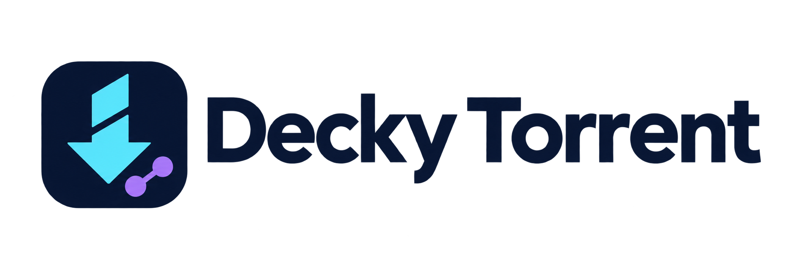

<h1></h1>

**Catálogo BitTorrent, downloads e atalhos da Steam no Modo Jogo.**

O Decky Torrent é um plugin experimental para o Decky Loader em dispositivos Linux x86-64 com o Modo Jogo da Steam. Você pode escolher uma loja da comunidade ou publicar seu próprio catálogo no GitHub.

[Baixar no GitHub Releases](https://github.com/markuusbrdev/deckytorrent/releases) · [Compatibilidade](#compatibilidade) · [Instalação](#instalar-pelo-decky) · [Catálogo próprio](#criar-seu-próprio-catálogo) · [Compilar](#gerar-o-zip-localmente)

## O que você pode fazer

| Área | Recursos |
| --- | --- |
| **Loja** | Navegue pelas capas em tela cheia, pesquise pelo título e filtre por categoria. Os cadastros mais recentes aparecem primeiro, e mais capas entram na tela conforme você rola. |
| **Downloads** | Acompanhe o progresso, pause, retome ou apague transferências. Os downloads continuam enquanto o dispositivo estiver acordado, mesmo com a Loja fechada. |
| **Biblioteca** | Escolha um `.exe` de um pacote concluído e crie um atalho na Steam. |
| **Catálogos da comunidade** | Troque a fonte da Loja pelo endereço de um repositório público do GitHub. O editor ajuda a cadastrar pacotes e capas no seu próprio catálogo. |

## Compatibilidade

Você precisa do [Decky Loader](https://github.com/SteamDeckHomebrew/decky-loader) funcionando no **Modo Jogo da Steam** em um sistema **Linux x86-64**. Isso inclui os seguintes ambientes:

- **Steam Deck e Steam Machine** com [SteamOS](https://store.steampowered.com/steamos).
- **PCs de mesa e portáteis** com SteamOS ou distribuições que oferecem o Modo Jogo, como [CachyOS Handheld Edition](https://wiki.cachyos.org/installation/installation_handheld/) e [Bazzite Deck](https://docs.bazzite.gg/Handheld_and_HTPC_edition/Steam_Gaming_Mode/).

## Instalar pelo Decky

1. Em [GitHub Releases](https://github.com/markuusbrdev/deckytorrent/releases), baixe o arquivo `decky-torrent-vX.Y.Z.zip` em **Assets**.
2. No Modo Jogo, abra as configurações do Decky e habilite o modo de desenvolvedor.
3. Abra **Desenvolvedor → Instalar plugin de arquivo ZIP** e selecione o ZIP inteiro, sem extrair.
4. Abra **Decky Torrent → Loja**, selecione uma capa e escolha uma pasta de destino.

O instalador inclui o `aria2c` para Linux x86-64. Se estiver migrando da versão **Catálogo Decky**, reinicie o dispositivo após instalar para carregar o novo nome. A pasta interna foi preservada para manter a fila existente.

## Trocar de loja

No Modo Jogo, abra **Decky Torrent → Loja → Trocar de loja**. O campo mostra o repositório em uso. Cole a URL de um repositório público, como `https://github.com/seu-usuario/minha-loja`, e clique em **Salvar loja**.

A loja padrão usa o catálogo deste projeto. Ao trocar de loja, o plugin procura `catalogo.json` na raiz da branch padrão do repositório e lê as capas pelos caminhos do campo `imagem`. Se o catálogo estiver ausente ou inválido, a loja anterior continua ativa. A escolha fica salva no dispositivo e os downloads existentes permanecem na fila. Para voltar ao catálogo original, selecione **Usar loja padrão**.

O plugin consulta o catálogo remoto ao abrir a **Loja**. Sempre que o GitHub informa o commit atual da branch, o plugin carrega o JSON e as capas desse mesmo commit. Use o ícone **Atualizar catálogo** para buscar novamente sem sair da tela. Se o GitHub estiver indisponível, a Loja usa a última versão válida salva. Na primeira abertura da loja padrão sem cache, o plugin usa o catálogo incluído no ZIP. A Loja mostra um ícone quando uma capa remota está indisponível. A Loja também tenta descobrir o tamanho pelos metadados dos magnets exibidos e guarda o resultado após uma consulta bem-sucedida.

Quando há uma versão estável mais recente com instalador ZIP no GitHub do Decky Torrent, a Loja mostra um aviso com **Ver release**. A consulta sempre usa o repositório oficial do plugin, inclusive ao usar um catálogo de outra comunidade. O botão abre a página da versão para você decidir quando baixar e instalar.

## Criar seu próprio catálogo

1. Crie um repositório **público** no GitHub e clone-o na sua máquina.
2. Crie `catalogo.json` na raiz, seguindo o exemplo abaixo, e guarde as capas em `imagens/`. Use conteúdos próprios ou que você tenha autorização para distribuir.
3. Publique o JSON e as capas na **branch padrão** do seu repositório. Se ela for `main`, você pode usar os comandos abaixo.
4. No Modo Jogo, abra **Loja → Trocar de loja** e cole a URL do seu repositório. A instalação existente do Decky Torrent pode usar esse catálogo.

```bash
git add catalogo.json imagens/
git commit -m "Publica catálogo da loja"
git push origin main
```

### Estrutura do repositório

```text
minha-loja/
├── catalogo.json
└── imagens/
    └── app-demo.webp
```

Exemplo de `catalogo.json`:

```json
{
  "categorias": [
    { "id": "aplicativos", "nome": "Aplicativos" }
  ],
  "pacotes": [
    {
      "id": "app-demo",
      "nome": "Aplicativo de teste",
      "magnet": "magnet:?xt=urn:btih:0123456789abcdef0123456789abcdef01234567",
      "imagem": "imagens/app-demo.webp",
      "categoria": "aplicativos"
    }
  ]
}
```

- Troque o magnet de exemplo pelo link real do seu pacote. O plugin aceita o info hash BitTorrent v1 com 40 caracteres em hexadecimal ou 32 em Base32.
- Use IDs únicos de até 64 caracteres, com letras minúsculas, números, hífen ou sublinhado, começando por uma letra ou número. Em cada pacote, `categoria` deve corresponder ao ID de uma categoria. Preserve os IDs ao renomear itens.
- O JSON remoto tem limite de 1 MiB. O campo `imagem` é relativo à raiz e deve apontar para uma capa PNG, JPEG ou WebP. A Loja aceita `imagens/`, `images/` e `image/`. Para usar o editor e o monitor de publicação, use `imagens/`.

### Editar pelo navegador

Para gravar direto no projeto sem vincular a pasta, abra [`editor/abrir-editor.sh`](editor/abrir-editor.sh) ou execute este comando na raiz:

```bash
python3 scripts/abrir-editor.py
```

O atalho abre o `index.html` no Firefox e usa um serviço local acessível apenas pela sua máquina. **Salvar pacote** grava o JSON e a capa na pasta do projeto. Mantenha o processo aberto enquanto usa o editor.

Abra [`editor/index.html`](editor/index.html) pelo gerenciador de arquivos. O catálogo e as capas do projeto aparecem automaticamente, mesmo offline. Se copiar o editor para outro repositório, copie a pasta `editor/` inteira e execute `python3 scripts/publicar-catalogo.py --sync-editor` nesse repositório para gerar a cópia local a partir do seu `catalogo.json`.

No Chrome ou Edge, use **Vincular pasta do projeto** para autorizar a gravação direta. **Salvar pacote** atualiza o JSON, grava a capa e atualiza a cópia usada na próxima abertura. O editor reutiliza a autorização se o navegador a mantiver. Se editar o JSON fora do editor, rode `python3 scripts/publicar-catalogo.py --sync-editor` para atualizar a cópia sem publicar no Git.

Selecione um arquivo `.torrent` BitTorrent v1 ou híbrido para preencher automaticamente o campo **Link magnet**. A conversão é local, sem upload. O catálogo guarda o magnet e os trackers extraídos do arquivo.

Nos dois modos, ao digitar um título, o editor sugere capas da Steam quando encontra o jogo. Selecione uma sugestão e salve o pacote para copiar a capa para `imagens/`. A busca usa o App ID do Wikidata, consulta os metadados no SteamCMD API e carrega a imagem do CDN da Steam. Ela precisa de internet. Você também pode enviar uma capa manualmente.

Ao abrir o HTML diretamente, sem vincular a pasta, **Salvar pacote** guarda o catálogo e as novas capas no navegador, inclusive ao atualizar ou reabrir a página. Use **Exportar ZIP** para levar as alterações aos arquivos do projeto. Extraia o ZIP na raiz do repositório e mantenha as capas existentes que você não carregou no editor. **Importar catálogo** continua disponível para abrir um arquivo de outro projeto.

### Publicar automaticamente ao salvar

No Linux, incluindo SteamOS, copie [`scripts/publicar-catalogo.py`](scripts/publicar-catalogo.py) para a pasta `scripts/` do seu clone. Com o Git autenticado e a branch local `main` sincronizada com `origin/main`, execute na raiz:

```bash
python3 scripts/publicar-catalogo.py
```

Abra o editor pelo atalho local ou vincule a mesma pasta no navegador. Enquanto o monitor estiver aberto, ele faz commit e push do catálogo, das capas referenciadas e da cópia do editor, quando presente, ao salvar. O terminal mostra o resultado. Use `Ctrl+C` para parar ou execute `python3 scripts/publicar-catalogo.py --once` para publicar alterações já gravadas.

## Gerar o ZIP localmente

```bash
npm ci
npm run typecheck
npm run build
python3 scripts/package-plugin.py --aria2 /caminho/para/aria2c --aria2-source /caminho/para/aria2-fontes.tar
```

Forneça um `aria2c` x86-64 portátil e o pacote de fontes correspondente. O instalador é gerado em `release/`.

## Fluxo de downloads

1. Abra **Loja**, escolha uma categoria e selecione a capa do pacote. Escolha uma pasta. O plugin cria uma subpasta exclusiva para o pacote.
2. Abra **Downloads**, pause, continue e feche o painel. Ao reabrir, confira o progresso. O backend guarda a fila e o aria2 preserva os dados parciais para retomada.
3. Ao terminar, confira a notificação e o estado **Concluído** em Downloads. O aria2 usa `--seed-time=0`. Pode haver upload durante o download.
4. Reabra o painel do **Decky Torrent**, escolha **Adicionar à Steam** e selecione o `.exe` do pacote. Confira o atalho na biblioteca. Para executar um programa Windows no Linux, habilite o Proton nas propriedades do atalho conforme necessário.

A fila do plugin funciona em segundo plano enquanto o dispositivo está acordado. Reiniciar o backend interrompe a transferência até que ele recarregue o estado. A API de atalhos pertence ao cliente Steam e deve ser validada na versão instalada do cliente Steam.

Na tela **Downloads**, **Apagar** pede confirmação. Para downloads incompletos, a confirmação cancela a transferência e exclui a subpasta do pacote. Para concluídos, a confirmação remove a entrada da fila e mantém os arquivos e atalhos.

## Licença

Consulte a [licença do projeto](LICENSE).
